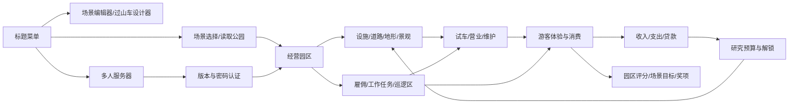
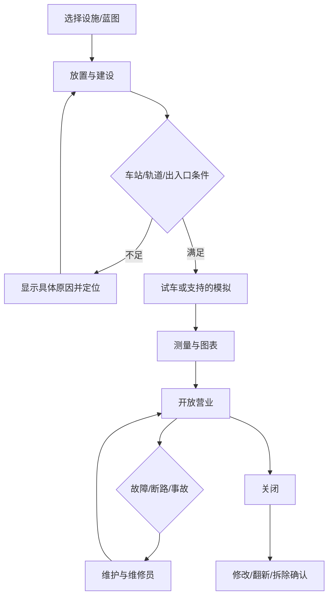
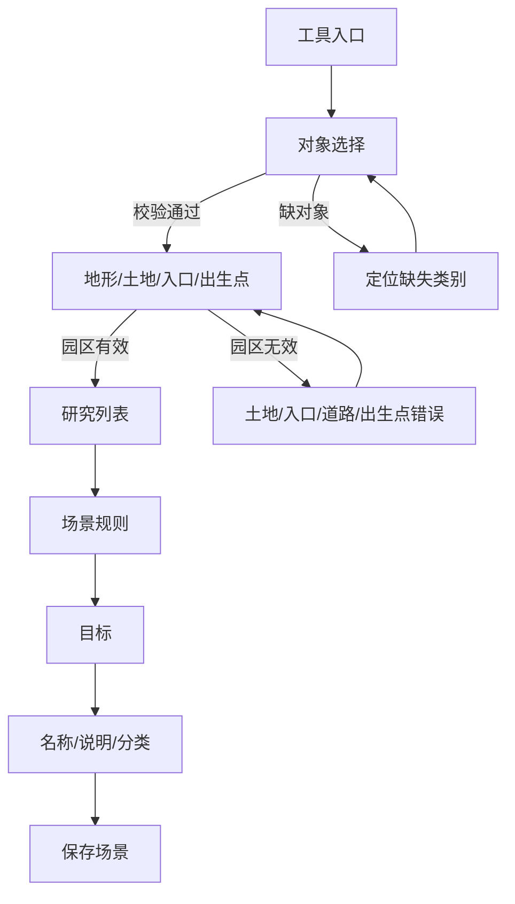
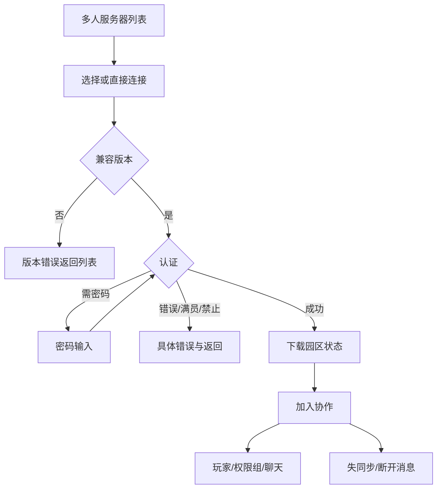

# OpenRCT2 功能流程与状态制作合同

核实日期：2026-10-26（America/New_York）。功能参考：`https://github.com/OpenRCT2/OpenRCT2.git`，固定提交 `52a55c3e8da5972460642bdfed61d091fe9cabfd`。以下路径均相对本任务 `reference/OpenRCT2`。这是源码核实与美术设计输入，不是运行验收或 Unity 实现证明。

## 已实际阅读的材料

- `F:/work/image/AGENTS.md`；检查了 `E:/`、`E:/work/`、`E:/work/image/`、本对话根目录的 AGENTS，未发现额外上级规则文件。参考仓库 `rg --files -g AGENTS.md` 没有结果。
- `readme.md` 的玩法、原作资料依赖、沙盒与场景、协作多人、贡献与许可证说明；`src/openrct2/readme.md` 的模块职责；`docs/save-format.md` 的存档与场景结构；`.gitattributes`；`assets.json` 的外部对象、音频与标题序列依赖。
- 窗口源码：TitleMenu、ScenarioSelect、TopToolbar、GameStatusBar、NewsTicker、NewRide、TrackList、TrackDesignPlace、RideConstruction、MazeConstruction、Ride、Guest、GuestList、Staff、StaffList、PatrolArea、Park、Finances、NewCampaign、Research、Footpath、Land、Water、Scenery、SceneryScatter、Banner、Sign、ClearScenery、EditorStepController、MapGen、Map、LoadSave、SavePrompt、OverwritePrompt、ObjectLoadError、TrackDesignManage、ServerList、NetworkStatus、Multiplayer、Options、ShortcutKeys 的有关定义、事件与状态片段。
- 逻辑源码：`ride/Ride.cpp` 的运行状态支持、车站/入口/出口检查和故障；`actions/ride/RideSetStatusAction.cpp`；`actions/track/TrackPlaceAction.cpp`；`actions/park/LandBuyRightsAction.cpp`、`ParkSetLoanAction.cpp`、`ParkMarketingAction.cpp`、`ParkSetResearchFundingAction.cpp`；`actions/peep/StaffHireNewAction.cpp`、`StaffSetPatrolAreaAction.cpp`；`management/Research.cpp` 与 `Marketing.cpp`；`scenario/Scenario.cpp`、`ScenarioObjective.h/.cpp`；`scenes/editor/EditorStep.h` 与 `EditorController.cpp`；`network/NetworkTypes.h` 与 `NetworkBase.cpp`；`openrct2-ui/interface/Chat.cpp`。

核实方式为阅读源文件和定向搜索实现，未启动原游戏。原作 RCT2 资料没有随代码仓库取得，不能宣称全部商业图片已经存在。本阶段重新制作道家 UI，仅以原作功能为依据，不直接移用其商业游戏精灵。

## 游戏类型与范围约束

OpenRCT2 是游乐园建造经营模拟。玩家负责设施、商店、服务、游客幸福、员工、道路、景观、财务、研究、场景目标与协作建园。道家化将这些内容表现为仙山游园、青云飞车、丹茶铺等美术示例；这些临时名称不改写功能含义。

不加入 RPG 账号登录/选角、主角属性装备、技能战斗、玩家背包仓库、抽卡、充值、签到、邮件、公会、好友、传送或副本。适用的替代项是本地场景选择、多人服务器与密码、游客状态与携带物、商店商品/票价、园区目标与奖项、经营消息。

独立自动更新启动器在 README 被提及，但并非本主仓已经实现的游戏内更新系统。若制作资料检查/更新/新手图解，必须标为建议补充或依赖入口方案。未验证的自动重连、云存档、教程/战役任务奖励领取也不应标为已有。

## 核心关系图

## 关键流程中的禁止误读

1. **设施不是只有开/关。** `Ride.cpp:93` 明确十个页签：总览、车辆、运行、维护、配色、音乐、测量、图表、收入、顾客。`Ride.cpp:626` 按设施类型决定是否支持试车和模拟；无试车模式的商店不能套过山车逻辑。`RideSetStatusAction.cpp:54` 查询操作是否允许，状态为关闭、测试、开放、模拟。`RideFlag::brokenDown`/crashed 为另外的标志，故障应作为覆盖提示。
2. **建造条件具有具体原因。** `TrackPlaceAction.cpp:85` 依次检查对象、方向坡度、暂停规则、边界、土地所有权、元素上限、高度、地下/水面及支撑条件。UI要保留原因文字和定位/取消出口，不统一写“失败”。`Ride.cpp:2349` 检查车站；`:2375` 检查入口出口，商店/服务设施在这里豁免。不能要求所有轨道闭环或所有建筑单独建出入口。
3. **道路的连通是玩法。** `Footpath.cpp:161` 有普通道路、排队路、栏杆、四方向、坡度、地面、桥隧及区域拖建。建设/出入口状态稿需展示道路连接，不能只给一个建筑卡片。`Ride.cpp:2024` 有未连接入口/出口的消息。
4. **游客不是玩家角色。** `Guest.cpp:58` 有总览、状态、乘坐记录、财务、想法、携带物、调试七页；`:94` 列出幸福感、体力、饥饿、口渴、眩晕和如厕。`:499` 无金钱模式禁用财务页，未启用调试时禁用调试页。携带物不能被设计成玩家整理/穿戴背包。
5. **员工需要巡逻与岗位选项。** `Staff.cpp:49` 有总览、选项、统计；`:404` 解雇、`:431` 巡逻入口。四岗位为清洁、维修、保安、表演者；不同岗位可用选项不同。`StaffSetPatrolAreaAction.cpp:48` 校验员工/地图范围，巡逻是地图画区而非简单下拉岗位。
6. **研究自动解锁，没有领奖。** `Research.cpp:56` 四个拨款档；`:346` 初期研究→设计→完成设计→下一项；`:251` 有新设施/车辆/景观通知；`:134` 全部研究结束后资金归零。必须包含未知预计日期、未拨款、全部研究完毕等状态。
7. **财务与营销受场景规则约束。** `Finances.cpp:36` 六页：收支、现金、园区价值、利润、营销、研究。`ParkSetLoanAction.cpp:40` 借款上限、负值与还款现金检查。`ParkMarketingAction.cpp:48` 检查营销禁止规则；`NewCampaign.cpp:349` 未选推广对象时禁用开始。营销结束没有额外“领取奖励”。
8. **目标成功/失败与奖项不同。** `ScenarioObjective.h:28` 列出目标类型；`ScenarioObjective.cpp:222` 的实际 Check 分派才决定检查逻辑。并非所有枚举项都有胜负检查，不把 legacy/haveFun 目标一概设计成倒计时任务。`Scenario.cpp:162`/`:171` 记录失败/成功；`Park.cpp:1083`/`:1090` 绘制结果，`:983` 允许登记完成者。场景记录不等于联网排行榜。
9. **编辑器是有步骤的完整生产流程。** `EditorStep.h:16` 定义对象→地形→研究列表→选项→目标→资料→保存七步，另有过山车设计器/蓝图管理器。`EditorController.cpp:97` 必要对象、`:169` 园区土地/入口/道路/出生点检查。步骤顺序与回退范围以原版控制器为准，不能把所有步骤虚构成随时任意跳转。
10. **存档错误有对象清单和下载状态。** `LoadSave.cpp:528` 排序；`:967` 名称非法等错误；SavePrompt有保存/不保存/取消；OverwritePrompt有覆盖/取消。`ObjectLoadError.cpp:44` 的下载器及 `:285` 起窗口支持对象名称/来源/类型、复制/全部下载；下载取消或失败应保留清单，不能直接显示“修复成功”。
11. **多人是协作经营。** `NetworkTypes.h:41` 定义连接状态与认证结果。`NetworkBase.cpp:2393` 支持错误版本、名称、密码、验证、满员、未知密钥和要求密码等分支；`:885` 检测失同步并显示网络消息。`Multiplayer.cpp:107` 权限组列表；聊天位于 `interface/Chat.cpp:51`，不能只按 windows 文件夹检索后漏掉聊天。
12. **设置按类别且多为即时变更。** `Options.cpp:71` 八页：显示、渲染、语言单位、音频、界面、操作、其他、高级。其控件包含禁闪电、放大 UI、触控、手柄、光标/拖拽/缩放。不要虚构旁白等完整辅助系统，也不要统一强加并不存在的“应用设置”步骤。`ShortcutKeys.cpp:575` 有重置确认，重绑有输入等待和移除绑定。

## 代表流程与返回出口

## 逐系统状态索引

下表对应 `state-contracts.json`。共 **21 个系统、125 个状态合同**。这是需要制作/映射的设计范围，表中存在不代表图片已完成。完整功能窗口清单由 `repo-ui-inventory.json` 单独核验；图像验收结果由总清单维护。

| 系统键 | 系统 | 状态数 | 用户流程 |
|---|---|---:|---|
| `start` | 开始与场景选择 | 4 | 标题菜单 → 选择新游戏 / 读取公园 / 多人 / 工具 → 选择场景 → 显示目标 → 进入公园 |
| `hud` | 经营主界面 | 4 | 查看园区 → 暂停 / 加速 / 缩放 / 旋转 → 打开建设或管理窗口 → 关闭返回园区 |
| `new-ride` | 新设施与蓝图 | 4 | 设施分类 → 选择类型 → 选择已有蓝图或自定义 → 旋转与放置 → 建造窗口 |
| `track-build` | 轨道与迷宫建设 | 7 | 选择起点与车站 → 逐段放置方向/坡度/曲线/特殊段 → 补齐入口出口与道路 → 模拟或试车 → 设施管理 |
| `ride-operation` | 设施经营与试车 | 9 | 设施总览 → 车辆与运行设置 → 模拟或试车 → 查看测量/图表 → 营业 → 维护或关闭 |
| `shops` | 商店与服务设施 | 4 | 选择商店/服务 → 放置并连接道路 → 设置售卖项目与价格 → 营业 → 查看成本/收益/顾客 |
| `paths-land` | 道路、地形与土地权利 | 5 | 选择工具 → 材质与范围 → 预览造价 → 放置/抬升/降低/移除 → 连通检查 |
| `scenery` | 景观与标牌 | 5 | 选择景观分类 → 搜索/收藏/筛选 → 选择对象与颜色 → 旋转/高度/散布 → 放置 → 编辑标牌 |
| `guests` | 游客名单与详情 | 6 | 游客列表 → 按行动/想法分组或筛选 → 打开游客 → 属性/财务/想法/携带物 → 定位与追踪 |
| `staff` | 员工与巡逻 | 6 | 员工列表分类 → 雇佣 → 员工详情 → 任务选项 → 绘制巡逻区 → 工作统计 → 解雇确认 |
| `park` | 公园管理与目标 | 6 | 主界面打开公园 → 入口营业与票价 → 评分/游客/统计 → 查看目标进度 → 达成或失败 → 完成记录 |
| `finances` | 财务与贷款 | 5 | 财务总览 → 收入支出账目 → 现金/园区价值/利润趋势 → 借贷或还贷 → 营销/研究预算 |
| `marketing` | 营销活动 | 6 | 财务营销页 → 选择营销类型 → 选设施或商品（适用时） → 设置周数 → 查看周费与总费 → 开始 → 活动列表与结束消息 |
| `research` | 研究与解锁 | 6 | 研究页 → 资金档位 → 研究优先类别 → 初期研究 → 设计 → 完成设计 → 新设施/车辆/景观可用 |
| `editor` | 场景编辑器 | 9 | 选择对象 → 编辑地形与入口 → 研究列表 → 场景选项 → 选择目标 → 场景资料 → 保存场景 |
| `mapgen` | 地图生成与视图 | 4 | 地图生成 → 设置尺寸/地形源 → 设置高度/水/森林 → 生成预览 → 确认后返回编辑 |
| `save-load` | 存档、读取与对象缺失 | 8 | 文件菜单 → 浏览目录/排序/预览 → 输入文件名 → 同名覆盖确认 → 保存或读取 → 缺对象时查看清单/下载 |
| `track-files` | 蓝图导入与管理 | 4 | 轨道蓝图列表 → 查看数据/缩略图 → 放置或导入 → 重命名/删除确认 |
| `multiplayer` | 多人协作 | 12 | 服务器列表 → 选择服务器/直接连接 → 版本检查 → 密码与认证 → 下载园区 → 加入协作 → 玩家/权限组/聊天 |
| `settings` | 设置、操作与可访问性 | 6 | 打开设置 → 选择类别 → 修改项 → 快捷键重绑/恢复 → 返回游戏 |
| `messages-support` | 消息、帮助与维护工具 | 5 | 经营消息 → 定位对象或打开窗口 → 历史消息 → 帮助/关于/更新日志 → 可选调试工具 |

## 设计与接入边界

- `state-contracts.json` 内 `logicBasis=existing` 表示该状态或相应失败分支有源代码依据；中文标题、临时道家名称、按钮措辞和组织方式是本次设计，不是原游戏逐字翻译。
- 进度/铜钱/游客名称/费用/日期/权限等动态内容单独排字；正式控件底图不烘焙这些内容。示例数据不能视为经济平衡。
- 相同空、锁定、禁用、警告、确认、危险、进度视觉可复用，资源映射需明确指向每个适用页面。按钮置灰之外须有图标/状态文案，不仅依赖颜色。
- 本合同没有请求制作 3D 游乐设施模型、整园可玩地图、角色动画或原游戏全部对象库。这些属于另行明确的世界美术/游戏资产生产；本次独立资源覆盖 UI 和预览所需的原画、控件、图标、装饰及静态缩略图。
- Unity 阶段仍需实现动态列表、图表、轨道/园区实时 viewport、工具鬼影、地图选择、权限、文件系统、对象下载、输入焦点、键盘导航等。静态预览只表达设计，不是可运行逻辑或性能验收。

## 来源与限制

功能依据为本地固定提交的源码，而非名称推断。主要公开来源可从 [OpenRCT2 固定提交](https://github.com/OpenRCT2/OpenRCT2/tree/52a55c3e8da5972460642bdfed61d091fe9cabfd) 复核。README 说明原作商业资料依赖；`assets.json` 指向若干独立的对象、音频、标题序列包，克隆主仓不等于取得所有运行所需的真实素材。

没有找到另行撰写的完整产品需求、美术验收合同或本任务专门交接；本次 UI 状态与流程从实现归纳，风格/尺寸/交付以用户当前要求及本项目美术合同为准。仅源码核实不证明本机运行了所有异常分支；存在条件编译、网络配置和插件动态窗口，接入时还需实际验证。
